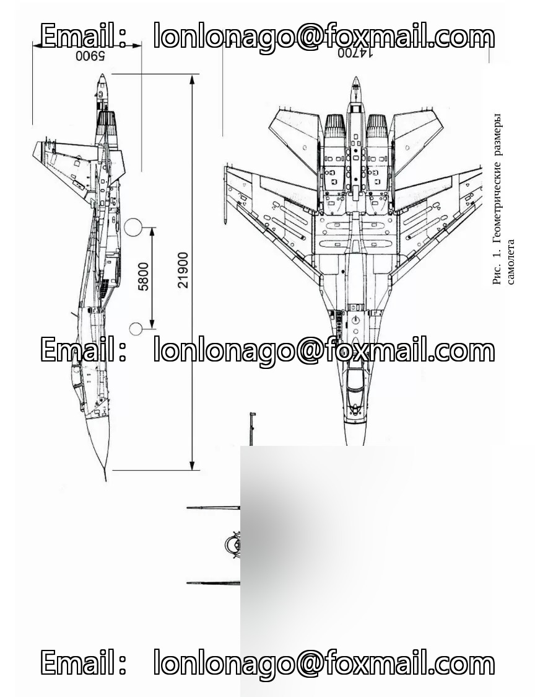
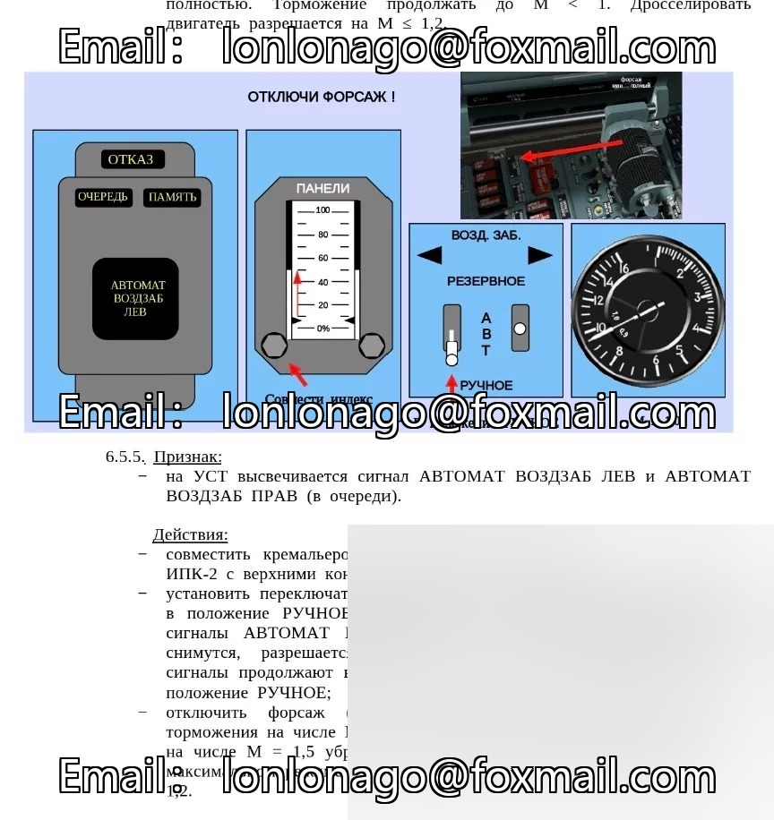
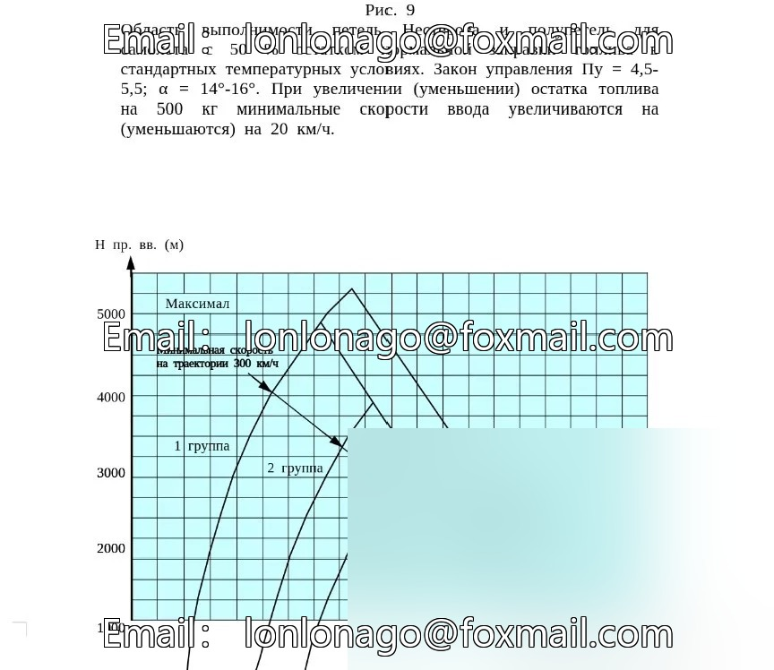
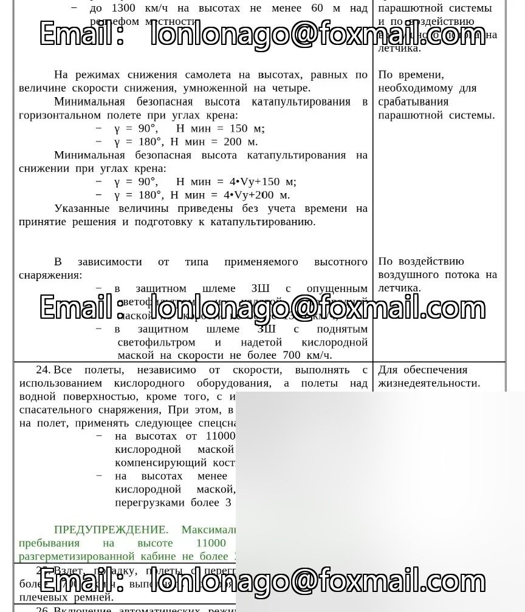
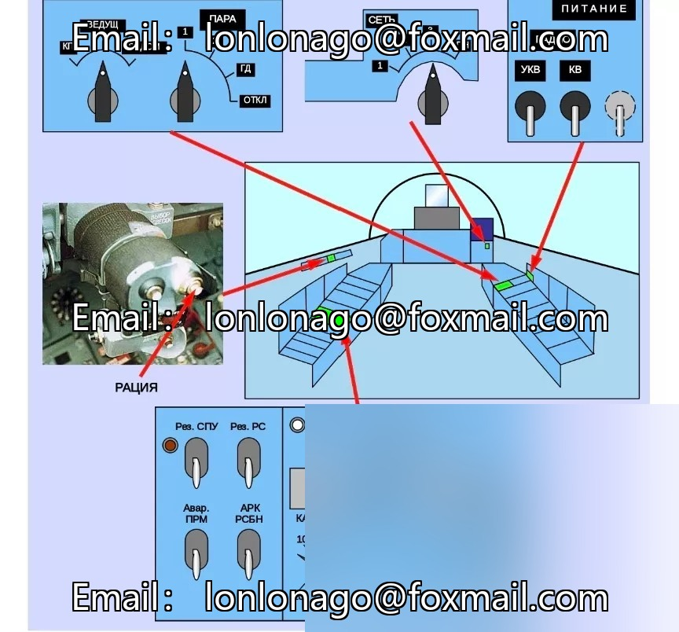
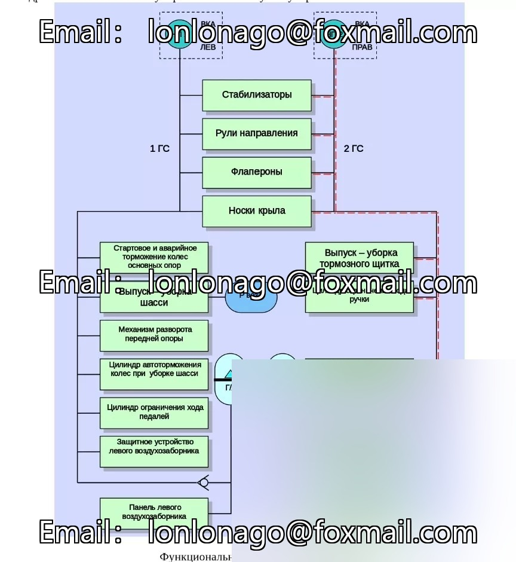

# Su-27SK flight operation manual

## Body

S-27SK Flight Operation Manual S-27SK Aircraft Flight Operation Manual (Volume I + Volume II)
word＋PDF , file 180 pages plus 110 pages, content covers S-27SK (export/simplified improved version) flight operation, flight usage guide, flight parameters, flight limitations, etc., suitable for aviation enthusiasts, pilots, and relevant professionals for reference.

435144
309352
1. Chinese Flight Operation Manual (Volume I) PDF , 180 pages
2. Detailed flight operation procedures, flight limitations, and flight parameters
3. Technical background of the SU-27SK (export/simplified improved model)
4. Suitable for aviation enthusiasts, pilots, and professional references

Su-27SCK is one of the export or simplified improved versions of Su-27, primarily targeting overseas users (for example, the Su-27 series introduced by China's Air Force in early years includes batches related to the SK type/export configuration, which is often associated with single-seat export standard). It is based on the Su-27 (Flanker) platform, focusing on air superiority combat, and possesses higher agility, long-range interception/air control capabilities.

2. Delivery method
not returned upon sale

This is the Su-27SK flight operation manual, covering the first and second volumes; it includes flight operations, usage guides, flight parameters and restrictions, along with various files and parameter information.

<!-- AI_ENRICHED -->

## Images

## Payment

Here is a pay link on Stripe ( https://buy.stripe.com/3cs8yP7sY87d0vu9AB ). Please contact me lonlonago@foxmail.com after funding $89, and I will send you a complete data files , thank you!

